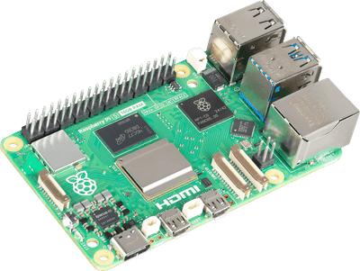

# Smart Retail Shelf Monitoring

**NAJZ Dev - Hamza Labbaalli Lab**  
Team: Hamza Labbaalli, Abdelouahed Id-boubrik, Yassine Maarouf, and Imane Idhaddou.

A simple computer-vision application that uses YOLOv8 to detect products on a
retail shelf and display a live stock report in a Tkinter dashboard. The
project is designed to run on a computer or a Raspberry Pi 5.

## Raspberry Pi 5

The monitor can run on a Raspberry Pi 5, using a small YOLOv8 model and a
moderate video resolution for better performance.



## Features

- Real-time product detection with YOLOv8.
- Product counts and low-stock highlighting.
- Pause and quit controls.
- Custom-model training support with Ultralytics.

## Setup

Use Python 3.9 or newer:

```bash
python -m venv .venv
source .venv/bin/activate
pip install -r requirements.txt
```

On Raspberry Pi OS, install Tkinter if it is not already available:

```bash
sudo apt install python3-tk
```

## Run the monitor

Place a video file in the project directory, then run:

```bash
python shelf_monitor.py --video sample_video.mp4 --model yolov8n.pt
```

Useful options:

```text
--video       Path to the shelf video
--model       YOLO weights file
--threshold   Maximum count considered low stock (default: 3)
```

The default model weights are downloaded automatically by Ultralytics when
needed. For a Raspberry Pi 5, use a small model such as `yolov8n.pt` and a
moderate video resolution for better performance.

## Train a custom model

With a Roboflow-exported `data.yaml` file:

```bash
python train_shelf_model.py --data path/to/data.yaml
```

The best weights are saved under:

```text
runs/detect/shelf_custom/weights/best.pt
```

Use the trained model with:

```bash
python shelf_monitor.py \
  --video sample_video.mp4 \
  --model runs/detect/shelf_custom/weights/best.pt
```

## Verify model weights

```bash
python verify_model.py
```

## Project files

| File | Purpose |
| --- | --- |
| `shelf_monitor.py` | Runs the detection dashboard |
| `train_shelf_model.py` | Trains a custom YOLOv8 model |
| `verify_model.py` | Downloads or verifies YOLOv8 nano weights |
| `requirements.txt` | Python dependencies |

## Credits

Created by **NAJZ Dev - Hamza Labbaalli Lab** with **Abdelouahed Id-boubrik,
Yassine Maarouf, and Imane Idhaddou**.
